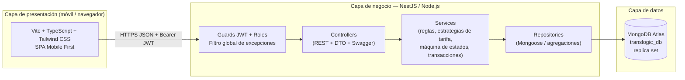
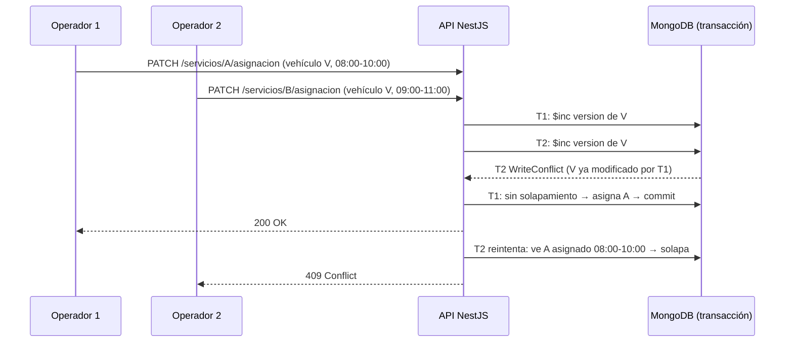
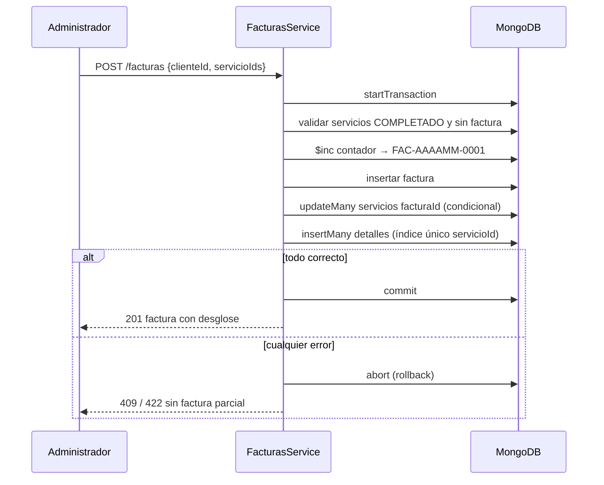

# Arquitectura

## B.1 Tres capas

## B.2 Patrones aplicados
| Patrón | Dónde | Por qué |
|---|---|---|
| Strategy + Factory | `tarifas/` | cada tipo de vehículo calcula su tarifa sin condicionales dispersos; agregar un tipo nuevo no modifica el código existente (principio abierto/cerrado) |
| Repository | `*.repository.ts` | aísla Mongoose; los servicios no dependen del motor de base de datos |
| DTO | `dto/` | contrato de entrada validado y documentado en Swagger |
| State machine | `servicios/estado.maquina.ts` | transiciones explícitas y verificables |
| Unit of Work (transacción) | facturación, asignación, cambio de estado | todo o nada |
| Optimistic locking | campo `version` | evita confirmar sobre datos desactualizados |

## B.3 Concurrencia en la asignación (caso crítico)

## B.4 Facturación atómica

