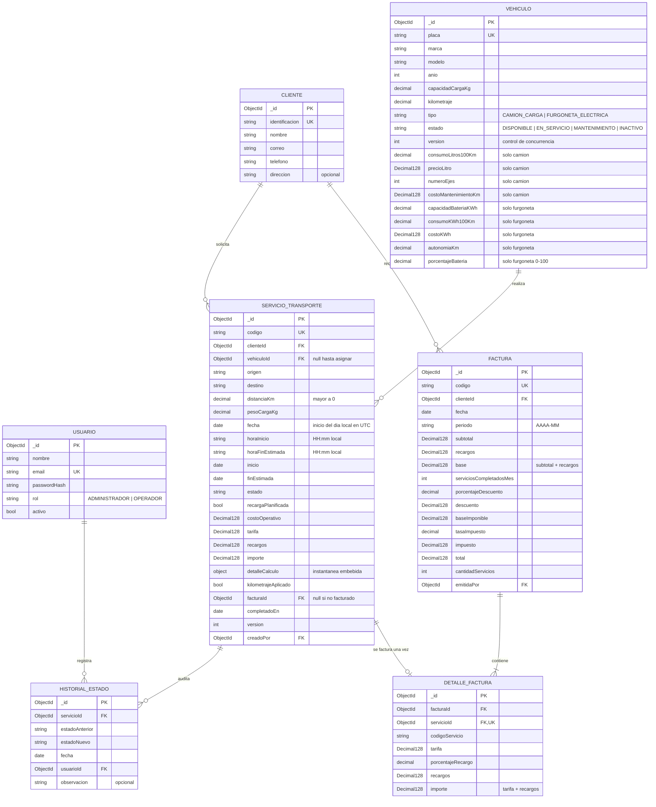

# Modelo de datos

## A.1 Selección del modelo: documental (MongoDB Atlas)

Se eligió un **modelo documental** con referencias entre colecciones por estas razones:

1. **Polimorfismo natural de vehículos.** `CamionCarga` y `FurgonetaElectrica` comparten atributos de `Vehiculo` pero tienen campos propios. En MongoDB se guardan en una sola colección `vehiculos` con un discriminador `tipo`; en relacional exigiría herencia por tablas (JOIN adicional) o una tabla con muchas columnas nulas. Una sola colección permite además unicidad de `placa` entre ambos tipos y agregaciones por `tipo` en un solo `$group`.
2. **Instantáneas de cálculo.** Cada servicio guarda el desglose de su tarifa (`detalleCalculo`) tal como se calculó; si luego cambia el precio del litro o el costo del kWh, la tarifa histórica no se altera. Un subdocumento flexible es ideal para esto.
3. **Agregaciones potentes para BI.** Las 8 consultas avanzadas y el dashboard se resuelven con el *aggregation framework* (`$facet`, `$setWindowFields`, `$lookup` con pipeline) directamente en el servidor de base de datos.
4. **Transacciones ACID multi-documento.** Atlas funciona como *replica set*, lo que habilita transacciones para facturación, finalización de servicios y asignaciones concurrentes; la ventaja clásica del modelo relacional en integridad se conserva.

**Embeber vs. referenciar:**
| Relación | Decisión | Motivo |
|---|---|---|
| Servicio → Cliente, Vehículo | Referencia (`ObjectId`) | entidades independientes, se consultan por separado |
| Servicio → detalleCalculo | Embebido | se lee siempre con el servicio y es inmutable |
| Servicio → HistorialEstado | Colección aparte | crecimiento ilimitado (auditoría *append-only*); evita documentos que crecen sin límite |
| Factura → DetalleFactura | Colección aparte | el índice único sobre `servicioId` garantiza que un servicio aparezca en una sola factura en toda la base |
| Vehículo → CamionCarga / FurgonetaElectrica | Discriminador en la misma colección | herencia sin JOIN |

## A.2 Diagrama del modelo

## A.3 Claves, índices y restricciones

| Colección | Índice | Tipo | Propósito |
|---|---|---|---|
| usuarios | `{ email: 1 }` | único | login, evita cuentas duplicadas |
| clientes | `{ identificacion: 1 }` | único | cédula/RUC sin repetir |
| vehiculos | `{ placa: 1 }` | único | búsqueda por placa y unicidad entre ambos tipos |
| vehiculos | `{ tipo: 1, estado: 1 }` | compuesto | filtros y agregaciones por categoría |
| servicios | `{ codigo: 1 }` | único | rechaza códigos duplicados |
| servicios | `{ vehiculoId: 1, inicio: 1, finEstimada: 1 }` | compuesto | detección de solapamiento de horarios |
| servicios | `{ clienteId: 1, estado: 1, fecha: 1 }` | compuesto | descuentos por mes y consultas por cliente |
| servicios | `{ estado: 1, fecha: -1 }` | compuesto | historial paginado y dashboard |
| servicios | `{ facturaId: 1 }` | simple | servicios pendientes de facturar |
| historial_estados | `{ servicioId: 1, fecha: 1 }` | compuesto | consulta de auditoría |
| facturas | `{ codigo: 1 }` | único | código correlativo sin repetir |
| facturas | `{ clienteId: 1, fecha: -1 }` | compuesto | consulta 8 y listado |
| detalles_factura | `{ servicioId: 1 }` | **único** | un servicio solo en una factura |
| detalles_factura | `{ facturaId: 1 }` | simple | armar el detalle de una factura |
| contadores | `{ _id: 1 }` | por defecto | secuencia de códigos de factura |

Restricciones adicionales mediante validadores `$jsonSchema` en cada colección (enums de estado, tipo y rol; mínimos `distanciaKm > 0`, `porcentajeBateria` 0–100, `anio` ≥ 1990) además de la validación de DTOs en NestJS: defensa en profundidad.

## A.4 Evolución del esquema
Las migraciones (`migrate-mongo`) crean colecciones, validadores e índices de forma versionada (`up`/`down`) y quedan registradas en la colección `changelog`. Los datos de prueba se cargan con `npm run seed`, que es determinístico: ejecutarlo dos veces produce la misma base.

## A.5 Ajustes respecto del diseño inicial

Durante la implementación se añadieron campos (ya reflejados en el diagrama) que no cambian las relaciones:

| Colección | Campos añadidos | Motivo |
|---|---|---|
| servicios | `horaInicio`, `horaFinEstimada`, `creadoPor` | editar el servicio con la hora local original y auditar quién lo creó |
| facturas | `base`, `baseImponible`, `serviciosCompletadosMes`, `cantidadServicios`, `emitidaPor` | el comprobante muestra el desglose guardado, sin recalcular en el frontend ni en el PDF |
| detalles_factura | `codigoServicio`, `porcentajeRecargo`, `importe` | la consulta 6 suma `importe` por tipo de vehículo y mes |
| historial_estados | `observacion` | motivo opcional de una cancelación |
| clientes | `direccion` | dato opcional del comprobante |

Todas las colecciones usan `versionKey: false`: el control de concurrencia usa el campo propio `version`.
Los vehículos se guardan con discriminadores de Mongoose (`discriminatorKey: 'tipo'`) y el validador `$jsonSchema` de la colección exige con `oneOf` los campos propios de cada subtipo.

