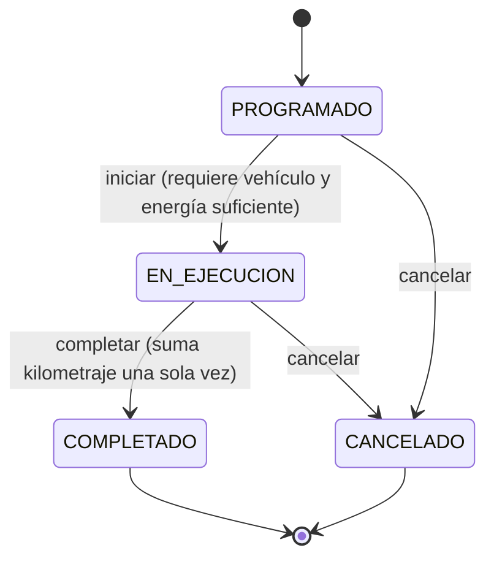

# Reglas de negocio

## C.1 Estados del servicio

## C.2 Tarifas
**Camión:** costo combustible = (d/100) × consumo × precio litro; costo operativo = combustible + d × mantenimiento/km; tarifa base = costo operativo × 1.35; +8 % si la carga supera el 80 % de la capacidad.

**Furgoneta:** costo energético = (d/100) × consumo kWh × costo kWh; tarifa base = (costo energético + 18) × 1.30; +10 % si la distancia supera el 80 % de la autonomía. Autonomía disponible = (capacidad batería × % / 100) / consumo × 100.

| Ejemplo | Cálculo | Tarifa |
|---|---|---|
| Camión 200 km, 30 L/100, $2.50, $0.10/km, carga 50 % | 150 + 20 = 170 × 1.35 | $229.50 |
| Mismo camión, carga 90 % | 229.50 × 1.08 | $247.86 |
| Furgoneta 100 km, 20 kWh/100, $0.10, autonomía 200 | (2 + 18) × 1.30 | $26.00 |
| Furgoneta 170 km (85 % de autonomía) | (3.40 + 18) × 1.30 × 1.10 | $30.60 |

## C.3 Facturación
Recargos por servicio sobre su tarifa: +6 % si > 300 km, +12 % si se realizó en domingo (acumulables). Un único descuento sobre (subtotal + recargos): 5 % con 3–5 servicios completados del cliente en el mes, 10 % con 6 o más. Luego impuesto configurable (`IVA_TASA`, por defecto 15 %).

| Concepto | Valor |
|---|---|
| Servicio A (350 km, domingo), tarifa | 100.00 |
| Recargo A (6 % + 12 %) | 18.00 |
| Servicio B, tarifa | 200.00 |
| Subtotal | 300.00 |
| Recargos | 18.00 |
| Base | 318.00 |
| Descuento 5 % (4 completados en el mes) | −15.90 |
| Base imponible | 302.10 |
| IVA 15 % | 45.32 |
| **Total** | **347.42** |

## C.4 Indicadores de rentabilidad
- Ingresos = Σ (tarifa + recargos) de servicios completados del período.
- Costos operativos = Σ costo operativo de esos servicios.
- Utilidad = ingresos − costos. Margen % = utilidad / ingresos × 100; si ingresos = 0, margen = 0 %.
- Eficiencia del vehículo = km recorridos / costo operativo (km por dólar); mayor es mejor. Se compara con el promedio de su tipo.

## C.5 Aritmética decimal
Los importes usan `decimal.js` en el backend y `Decimal128` en MongoDB. `0.1 + 0.2` en `number` de JavaScript da `0.30000000000000004`; en dinero ese error se acumula en facturas y reportes. El redondeo es *half up* a 2 decimales en cada importe final.
